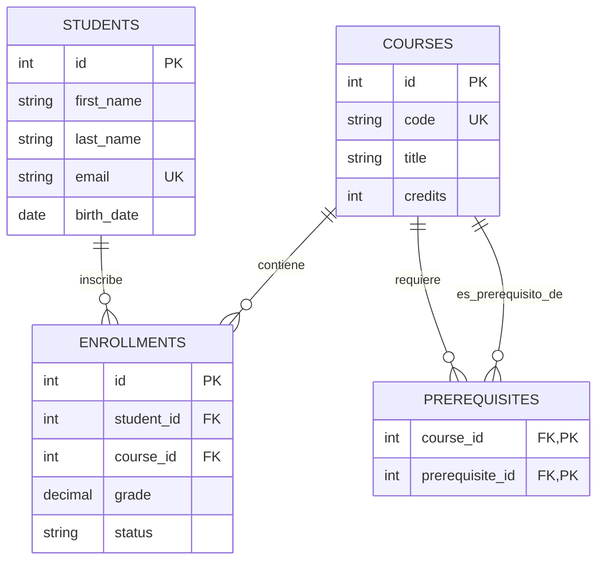

# 🗄️ Harvard University: CS50 SQL (Introduction to Databases with SQL)

<div align="center">

[](https://github.com/Sais-gallego/harvard-cs50-sql/actions)
[](https://www.sqlite.org/)
[](LICENSE)
[](https://cs50.harvard.edu/sql/)
[](https://github.com/Sais-gallego/harvard-cs50-sql)

**Implementaciones completas de diseño relacional en 3FN, indexación con árboles B-Tree, CTEs recursivas, vistas y transacciones ACID del programa oficial de Harvard University: *CS50's Introduction to Databases with SQL*, impartido por los profesores Carter Zenke y David J. Malan.**

**Autor:** Sergio Andrés Ipuz Saavedra · [@Sais-gallego](https://github.com/Sais-gallego)  
**Institución:** Harvard University (CS50)

---

</div>

## 📑 Tabla de Contenidos

- [Esquema de Base de Datos Relacional (3FN)](#-esquema-de-base-de-datos-relacional-3fn)
- [🎯 Conceptos Avanzados Implementados](#-conceptos-avanzados-implementados)
  - [1. Normalización y Restricciones de Integridad](#1-normalización-y-restricciones-de-integridad-3fn)
  - [2. Optimización e Índices B-Tree](#2-optimización-e-índices-b-tree-explain-query-plan)
  - [3. CTEs Recursivas (Consultas Jerárquicas)](#3-ctes-recursivas-consultas-jerárquicas)
  - [4. Transacciones ACID y Aislamiento](#4-transacciones-acid-y-aislamiento)
  - [5. Vistas Virtuales para Seguridad y Abstracción](#5-vistas-virtuales-para-seguridad-y-abstracción)
- [🧪 Pruebas Automatizadas (Unittest)](#-pruebas-automatizadas)
- [🚀 Guía de Inicio Rápido](#-guía-de-inicio-rápido)

---

## 📐 Esquema de Base de Datos Relacional (3FN)

El diseño implementa Tercera Forma Normal (3FN), eliminando redundancias y garantizando integridad referencial con cascadas estrictas.



---

## 🎯 Conceptos Avanzados Implementados

### 1. Normalización y Restricciones de Integridad (3FN)
- Llaves primarias autoincrementales, llaves foráneas (`FOREIGN KEY`) con políticas `ON DELETE RESTRICT` y restricciones compuestas (`CHECK`, `UNIQUE`).
- Eliminación de dependencias transitivas garantizando almacenamiento atómico.

### 2. Optimización e Índices B-Tree (`EXPLAIN QUERY PLAN`)
- Creación de índices compuestos para acelerar búsquedas y joins frecuentes:
  ```sql
  CREATE INDEX idx_enrollments_student_course ON enrollments (student_id, course_id);
  ```
- Reducción de coste computacional de escaneo secuencial completo ($\mathcal{O}(N)$) a búsqueda logarítmica en árbol B-Tree ($\mathcal{O}(\log N)$).

### 3. CTEs Recursivas (Consultas Jerárquicas)
- Resolución de árboles de dependencias y grafos acíclicos dirigidos (DAGs) de asignaturas y sus prerrequisitos mediante `WITH RECURSIVE`:
  ```sql
  WITH RECURSIVE course_chain AS (
      SELECT course_id, prerequisite_id, 1 AS depth
      FROM prerequisites WHERE course_id = ?
      UNION ALL
      SELECT p.course_id, p.prerequisite_id, cc.depth + 1
      FROM prerequisites p
      JOIN course_chain cc ON p.course_id = cc.prerequisite_id
  )
  SELECT * FROM course_chain;
  ```

### 4. Transacciones ACID y Aislamiento
- Operaciones atómicas con bloques `BEGIN TRANSACTION` y puntos de guardado (`SAVEPOINT`).
- Control estricto de reversión (`ROLLBACK`) ante fallos de saldo o inconsistencias, asegurando los principios de Atomicidad, Consistencia, Aislamiento y Durabilidad.

### 5. Vistas Virtuales para Seguridad y Abstracción
- Vistas precalculadas (`CREATE VIEW`) como `v_honors_students` que consolidan cálculos de promedios ponderados (GPA) sin duplicar datos en disco.

---

## 🧪 Pruebas Automatizadas

```bash
python -m unittest discover tests -v
```

### Resultados de la Suite (6/6 Passed ✅)
```text
test_acid_transaction_commit_and_rollback (test_sql.TestHarvardCS50SQL.test_acid_transaction_commit_and_rollback) ... ok
test_b_tree_indexing_optimization (test_sql.TestHarvardCS50SQL.test_b_tree_indexing_optimization) ... ok
test_multi_table_joins_and_aggregations (test_sql.TestHarvardCS50SQL.test_multi_table_joins_and_aggregations) ... ok
test_recursive_cte_prerequisites (test_sql.TestHarvardCS50SQL.test_recursive_cte_prerequisites) ... ok
test_schema_and_integrity_constraints (test_sql.TestHarvardCS50SQL.test_schema_and_integrity_constraints) ... ok
test_virtual_view_honors_students (test_sql.TestHarvardCS50SQL.test_virtual_view_honors_students) ... ok

----------------------------------------------------------------------
Ran 6 tests in 0.013s

OK
```

---

## 🚀 Guía de Inicio Rápido

1. **Clonar el repositorio:**
   ```bash
   git clone https://github.com/Sais-gallego/harvard-cs50-sql.git
   cd harvard-cs50-sql
   ```

2. **Ejecutar las pruebas:**
   ```bash
   python -m unittest tests/test_sql.py
   ```

---

<div align="center">
  <sub>Desarrollado con estándares de ingeniería de software por <b>Sergio Andrés Ipuz Saavedra</b> · Harvard CS50 SQL</sub>
</div>
